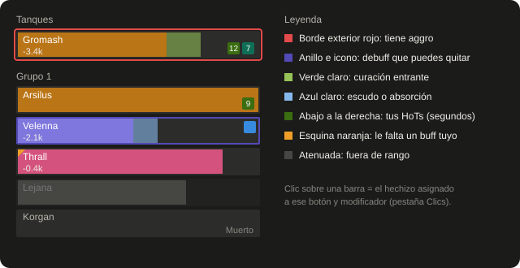

# Healsilus

[](https://github.com/jotagalindo/healsilus/actions/workflows/ci.yml)
[](https://github.com/jotagalindo/healsilus/releases)

Marcos de curación con click-casting (estilo HealBot) para **World of Warcraft: Forever**, hechos desde cero para las restricciones de addons de la arquitectura Midnight (valores secretos).

> **Estado: beta (v0.0.2).** Las pruebas offline pasan, pero falta la verificación en el juego ([checklist](docs/testing/in-game-checklist.md)). Si algo falla, abre un issue con la salida de `/hs diag`.



## Instalación

1. Descarga `Healsilus-X.Y.Z.zip` de la última [release](https://github.com/jotagalindo/healsilus/releases).
2. Descomprímelo en `World of Warcraft\_forever_\Interface\AddOns` (debe quedar la carpeta `AddOns\Healsilus`).
3. Desactiva HealBot para que no compitan por los clics y entra al juego: `/hs`.

Si actualizas desde otra versión, **cierra y abre el juego** (no basta `/reload`): las texturas nuevas de `Media` solo se cargan al arrancar.

## Qué hace

- Click-casting: botón del ratón + Alt/Ctrl/Shift → hechizo (con rango opcional), macro, objetivo o menú.
- Barras de grupo y banda (10/20/40), bloque de tanques, mascotas, objetivo y foco amistosos.
- Curación entrante y escudos, rango, aggro, muerto y desconectado.
- Tus HoTs con cuenta atrás, debuffs con el color del tipo de dispel y buffs tuyos que faltan (con su icono). HoTs, debuffs y buff que falta se colocan donde quieras: dentro o fuera de la barra, con desplazamiento, tamaño y dirección.
- Barra de maná, ira o energía, eligiendo qué recursos se ven. Opacidad fuera de alcance y con la vida llena.
- Plantillas de disposición de la barra: dos propuestas sin solapes ("Sanador" y "Banda compacta") y las tuyas guardadas.
- Modo mover: arrastras cada bloque entero y se pega a los demás con guías de alineación (imán), con rejilla opcional.
- Perfiles por clase, por personaje y por especialización. Exportar e importar.
- **Estilos (skins)** compartidos por toda la cuenta: tamaño y disposición, textura (también de LibSharedMedia), fondo, colores de la curva de vida, fuente y posición de cada texto, esquinas de los iconos y forma del aviso de dispel. Cuatro de serie, y cambio automático según estés solo, en grupo o en banda de 10/20/40. Se exportan e importan aparte.
- Perfil de serie para druida.

## Normas de Blizzard

El addon nunca decide qué hechizo lanzar ni a quién: cada lanzamiento es un clic tuyo sobre una asignación fija. Los valores secretos solo se pasan a widgets nativos y nada seguro se toca en combate.

## Instalación (desarrollo)

```powershell
powershell -ExecutionPolicy Bypass -File tools/link-addon.ps1
```

Luego, en el juego, `/reload` y `/hs`.

## Comandos

| Comando | Qué hace |
|---|---|
| `/hs` | Abre la configuración |
| `/hs diag` | Diagnóstico del cliente y del addon |
| `/hs lock` | Bloquea o desbloquea los marcos para moverlos |
| `/hs move` | Modo mover (bloques de ejemplo, imán y rejilla) |
| `/hs toggle` | Activa o desactiva Healsilus en este personaje |
| `/hs preview 5` (10, 20, 40) | Vista previa con miembros falsos; `/hs preview` la cierra |
| `/hs debug` | Mensajes de depuración |
| `/hs minimap` | Muestra u oculta el botón del minimapa (clic izquierdo: configuración; derecho: bloquear marcos) |

## Desarrollo

Requisitos: Docker. El contenedor trae LuaJIT (Lua 5.1, la versión del cliente), git, shellcheck y zip.

```powershell
docker build -t healsilus-dev tools
```

```powershell
docker run --rm -v "${PWD}:/addon" healsilus-dev
```

El segundo comando ejecuta `luajit tools/check.lua` (TOC y ficheros, sintaxis, globales, patrones prohibidos,
traducciones) y `luajit tests/run.lua` (pruebas offline sobre un cliente simulado, `tests/lib/wow_stubs.lua`).
Sin Docker también funcionan con LuaJIT instalado (`scoop install luajit`): `luajit tools/check.lua` y
`luajit tests/run.lua`.

Para generar el zip en local (queda en `dist/`):

```powershell
docker run --rm -v "${PWD}:/addon" healsilus-dev sh tools/package.sh
```

El script comprueba que existen todos los ficheros que lista el TOC y que no hay ningún `.lua` del addon fuera del
TOC (el juego no lo cargaría). En Windows sin Docker, `tools/package.ps1` hace el mismo zip.

### Integración continua

[`.github/workflows/ci.yml`](.github/workflows/ci.yml) se ejecuta en cada push a `main` y en cada pull request:

- **Lint**: `tools/check.lua`, shellcheck de `tools/package.sh` y actionlint de los workflows.
- **Tests**: `tests/run.lua` y empaquetado; el zip queda como artefacto de la ejecución.

### Publicar una release

1. Cambia `## Version:` en `Healsilus.toc` y `ns.version` en `Core/Init.lua` (por ejemplo a `0.0.3`) y escribe las
   notas en `docs/releases/v0.0.3.md`.
2. Llévalo a `main` (merge de la pull request). No hace falta crear la etiqueta.

[`.github/workflows/release.yml`](.github/workflows/release.yml) se ejecuta en cada push a `main`: si la versión del
TOC aún no tiene release, pasa las comprobaciones y las pruebas, empaqueta el addon, crea la etiqueta `v0.0.3` sobre
ese commit y publica la release con `Healsilus-0.0.3.zip` y las notas de `docs/releases/` (o, si no hay, las
generadas a partir de los commits). Si la versión ya tiene release, no hace nada. Mientras la versión sea 0.x (fase
beta, pendiente de probar en el juego) la release se publica como *prerelease*; lo mismo ocurre con cualquier
etiqueta con guion (`v1.1.0-beta1`).

También se puede publicar subiendo la etiqueta a mano (`git tag v0.0.3` y `git push origin v0.0.3`; debe coincidir
con el TOC). Si creas la release desde la web con una etiqueta nueva, el workflow solo le adjunta el zip.

La verificación en el juego está en [docs/testing/in-game-checklist.md](docs/testing/in-game-checklist.md).

| Fichero | Responsabilidad |
|---|---|
| `tools/check.lua` | Comprobaciones estáticas |
| `tests/run.lua` | Pruebas offline (lista de ficheros de prueba) |
| `tools/package.sh` | Zip de la release (`tools/package.ps1`: lo mismo en PowerShell) |
| `tools/Dockerfile` | Entorno de desarrollo y CI |
| `tools/icons/` | Logo e iconos (SVG) y `build.py`, que genera los `.tga` de `Media/` |
| `.github/workflows/` | CI y release |
