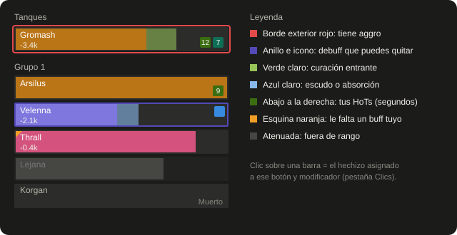

# Healsilus — diseño v1

Addon de marcos de curación con click-casting (estilo HealBot) para **World of Warcraft: Forever**, escrito desde cero para funcionar con las restricciones de addons de la arquitectura Midnight (valores secretos).

Fecha: 2026-11-26 · Autor: jotagalindo

## 1. Contexto

### 1.1 Cliente objetivo

| Dato | Valor |
|---|---|
| Carpeta | `C:\Program Files (x86)\World of Warcraft\_forever_\` |
| Producto / build | `wowf` · `1.60.1.71139` |
| TOC | `## Interface: 16001` |
| Contenido | Época vanilla, nivel 60, 9 clases, rangos de hechizo, doble especialización desde nivel 40, bandas de 10/20/40 |
| API | Arquitectura de UI de Mainline con las restricciones de Midnight/12.1 |

### 1.2 Por qué HealBot funciona "regular" en Forever

HealBot (v26.11.20, ~150.000 líneas) se escribió antes de los valores secretos. Su lógica central compara y opera con vida, auras y rango (umbrales, ordenar, colores calculados en Lua). Los parches de Forever (`HealBot_Forever*.lua`, `HealBot_CombatAuras.lua`) están enganchados con `hooksecurefunc` y, cuando un valor es secreto, lo sustituyen por `0` o "en rango". En combate eso produce datos falsos, trabajo repetido y errores.

### 1.3 Reglas de la plataforma (no negociables)

1. **Valores secretos**: en combate, encuentros y mapas restringidos, `UnitHealth`, `UnitHealthMax` (no jugadores), auras, rangos de hechizo, etc. pueden devolver secretos. El código del addon **nunca** compara, opera, indexa ni usa como clave un secreto. Solo los pasa a APIs que los aceptan (`StatusBar:SetValue`, `FontString:SetText`, curvas, `Region:SetAlphaFromBoolean`…).
2. **Bloqueo de combate**: no se crean marcos seguros, no se cambian atributos seguros, no se reanclan marcos protegidos y no se crean `AuraContainer` mientras `InCombatLockdown()` sea verdadero.
3. **Sin automatización**: cada lanzamiento sale de un clic del jugador sobre un botón seguro con un hechizo fijo por botón + modificador. El addon nunca elige hechizo ni objetivo.
4. `COMBAT_LOG_EVENT_UNFILTERED` no está disponible; no se usa.
5. Ningún atributo seguro se deriva de un valor secreto.

## 2. Alcance v1

Incluido:
- Click-casting sobre marcos de grupo y banda (botón × modificador → hechizo, hechizo con rango, macro, objetivo o menú).
- Barras de vida con color de clase o por vida, texto de vida opcional, curación entrante y escudos.
- Rango (atenuado), aggro (borde), estados muerto/fantasma/desconectado.
- Tus HoTs y escudos con cuenta atrás; debuffs con color del tipo de dispel (solo dispelables o todos).
- Buffs que faltan (fuera de combate).
- Bloques: grupo/banda, tanques, mascotas, objetivo y foco amistosos. Ocultar marcos de Blizzard.
- Perfiles clase → PJ → especialización con copia, restablecer y exportar/importar.
- Panel de configuración propio con pestañas, enlazado en Opciones → AddOns.
- Perfil de serie para **druida**. El resto de clases se configuran a mano.
- Textos en `enUS` y `esES` (`esMX` usa `esES`).

Excluido de v1 (decisión explícita del usuario): perfiles de serie para sacerdote, paladín y chamán; ordenar por vida (imposible con secretos); cualquier lógica que decida lanzamientos.

## 3. Arquitectura

### 3.1 Estructura de archivos

El repositorio **es** la carpeta del addon. Para desarrollar se crea un *junction* `_forever_\Interface\AddOns\Healsilus` → repositorio. WoW ignora `docs/` y `tests/`.

```
Healsilus.toc
Core/Init.lua            espacio de nombres, constantes, utilidades seguras ante secretos
Core/Events.lua          bus de eventos interno (Register/Fire) y marco de eventos de WoW
Core/CombatQueue.lua     cola de acciones diferidas hasta PLAYER_REGEN_ENABLED
Core/Database.lua        HealsilusDB: valores por defecto, versión y migraciones
Core/Profiles.lua        resolución del perfil activo, copia, restablecer
Core/Serializer.lua      exportar/importar perfiles como texto
Data/Spells.lua          resolución de hechizos por ID (nombre localizado, rangos conocidos)
Data/Druid.lua           perfil de serie del druida
Frames/Media.lua         texturas, fuentes y colores de clase
Frames/Curves.lua        curvas de color por vida (C_CurveUtil)
Frames/UnitButton.lua    construcción y actualización de cada barra
Frames/Prediction.lua    curación entrante y escudos (calculador nativo)
Frames/ClickCast.lua     asignaciones → atributos seguros
Frames/Headers.lua       cabeceras seguras, precreación, objetivo/foco, ocultar Blizzard
Auras/Containers.lua     AuraContainer de HoTs propios y de debuffs
Auras/MissingBuffs.lua   detección de buffs que faltan fuera de combate
UI/Widgets.lua           controles reutilizables del panel
UI/Config.lua            ventana principal y pestañas
UI/TabClicks.lua
UI/TabFrames.lua
UI/TabAuras.lua
UI/TabBuffs.lua
UI/TabProfiles.lua
Frames/Preview.lua       vista previa con miembros falsos (marcos no seguros)
Core/Diagnostics.lua     /hs diag: APIs presentes, autopruebas, IDs sin resolver, errores
Core/Commands.lua        /hs, /hs diag, /hs debug, /hs lock, /hs preview
Core/Bootstrap.lua       arranque: ADDON_LOADED, PLAYER_LOGIN, cambios de libro y especialización
Locales/enUS.lua
Locales/esES.lua
tests/                   pruebas offline (Lua 5.1/LuaJIT + stubs de la API)
tools/check.lua          comprobaciones estáticas (TOC, sintaxis, globales, patrones prohibidos, traducciones)
```

Orden de carga en el TOC: Init → Locales → Events → CombatQueue → Database → Data/Spells → Data/Druid → Profiles → Serializer → Media/Curves → ClickCast → Prediction → Auras → UnitButton → Headers → Preview → UI → Diagnostics → Commands → Bootstrap.

### 3.2 TOC

```
## Interface: 16001
## Title: Healsilus
## Notes: Click-casting healing frames built for WoW Forever's addon restrictions.
## Notes-esES: Marcos de curación con click-casting hechos para las restricciones de addons de WoW Forever.
## Notes-esMX: Marcos de curación con click-casting hechos para las restricciones de addons de WoW Forever.
## Author: jotagalindo
## Version: 0.0.1
## SavedVariables: HealsilusDB
## IconTexture: Interface\Icons\Spell_Nature_HealingTouch
```

### 3.3 Comunicación entre módulos

- Todo el addon vive en una tabla privada `ns` (segundo argumento de cada archivo) y expone solo `Healsilus` como global para comandos y depuración.
- `ns.Events:Register(name, callback)` / `ns.Events:Fire(name, ...)` para eventos internos: `PROFILE_CHANGED`, `SETTINGS_CHANGED(section)`, `ROSTER_CHANGED`, `COMBAT_ENDED`.
- `ns.CombatQueue:Run(key, fn)`: si no hay combate ejecuta `fn` ya; si lo hay, la guarda por `key` (la última petición con la misma clave gana) y la ejecuta en `PLAYER_REGEN_ENABLED` en orden de llegada.

## 4. Datos y perfiles

### 4.1 Esquema de `HealsilusDB`

```lua
HealsilusDB = {
  version = 1,
  classProfiles = { DRUID = Profile, ... },     -- base compartida por clase
  characters = {
    ["Arsilus-Bah"] = {
      class = "DRUID",
      useClassProfile = true,                   -- false → usa 'own'
      own = Profile,                            -- opcional
      useSpecProfiles = false,                  -- true → usa specs[n] si existe
      specs = { [1] = Profile, [2] = Profile }, -- opcional
    },
  },
  framePositions = { party = {point, x, y}, tanks = {...}, pets = {...}, target = {...}, focus = {...} },
  debug = false,
}

Profile = {
  bindings = { ["shift-1"] = Binding, ... },    -- clave: "<modificadores>-<botón>"
  frames = {
    width = 110, height = 34, spacing = 2, columns = 8, unitsPerColumn = 5,
    sortBy = "GROUP",                           -- GROUP | CLASS | ROLE
    growth = "DOWN",                            -- DOWN | RIGHT
    showSolo = true, showTanks = true, showPets = false, showTarget = true, showFocus = true,
    hideBlizzard = true, locked = true, castOnDown = false,
    texture = "BLIZZARD",                       -- BLIZZARD | RAID | FLAT (clave de Frames/Media.lua)
    colorMode = "CLASS",                        -- CLASS | HEALTH
    healthText = "DEFICIT",                     -- NONE | DEFICIT | PERCENT
    outOfRangeAlpha = 0.4,
  },
  auras = {
    hotsEnabled = true, hotsMax = 4, hotSpellIDs = { [774] = true, ... },
    debuffsEnabled = true, debuffsMax = 2, debuffsDispellableOnly = true,
    iconSize = 14,
  },
  buffs = {
    enabled = true,
    watched = { { spellID = 1126, groupSpellID = 21849, targets = "ALL" },
                { spellID = 467, targets = "TANKS" } },
  },
}

Binding = { kind = "spell", spellID = 774, rank = nil,       -- rango nil = el más alto aprendido
            fallbackSpellID = nil }                          -- opcional: se usa si spellID no se conoce
        | { kind = "macro", text = "/cast [@mouseover] Innervate" }
        | { kind = "target" } | { kind = "menu" }
```

Modificadores válidos, en este orden canónico: `alt`, `ctrl`, `shift` (combinables, p. ej. `alt-ctrl-1`). Botones: `1` izquierdo, `2` derecho, `3` central, `4`, `5`.

### 4.2 Resolución del perfil activo

`ns.Profiles.Resolve(db, characterKey, classToken, specIndex)` devuelve `profile, source`, donde `source` ∈ `"spec" | "character" | "class"` (el perfil de serie, una vez creado, se guarda como perfil de clase):

1. Si `useSpecProfiles` y `specs[specIndex]` existe → `spec`.
2. Si `useClassProfile == false` y `own` existe → `character`.
3. Si `classProfiles[classToken]` existe → `class`.
4. Si no, se crea `classProfiles[classToken]` desde el perfil de serie de la clase (druida) o desde un perfil vacío con marcos por defecto → `class`.

Los perfiles guardados son **completos**, sin herencia campo a campo. "Copiar" hace una copia profunda. Al cargar, `Database` rellena los campos que falten con los valores por defecto. Así una versión nueva del addon puede añadir opciones sin romper perfiles antiguos.

Disparadores de re-resolución: `PLAYER_LOGIN`, `ACTIVE_TALENT_GROUP_CHANGED` / `PLAYER_TALENTS_UPDATED` (el que exista; `/hs diag` lo informa) y los cambios desde la pestaña Perfiles. Aplicar el perfil pasa siempre por `CombatQueue:Run("applyProfile", ...)`.

### 4.3 Exportar / importar

`Serializer` convierte un `Profile` en una cadena `HS1:` + tabla Lua serializada a mano (solo tablas, cadenas, números y booleanos) + Base64. Al importar se valida el esquema campo a campo. Si algo no encaja, se rechaza todo con un mensaje que nombra el campo. Nunca se ejecuta `loadstring` sobre el texto importado.

## 5. Marcos

### 5.1 Cabeceras seguras

| Bloque | Plantilla | Atributos clave |
|---|---|---|
| Grupo/banda | `SecureGroupHeaderTemplate` | `showParty`, `showRaid`, `showPlayer`, `showSolo` (configurable), `groupBy`/`groupingOrder` según `sortBy`, `maxColumns`, `unitsPerColumn`, `point`, `columnAnchorPoint` |
| Tanques | `SecureGroupHeaderTemplate` | `roleFilter = "TANK,MAINTANK"`, `showRaid`, `showParty` |
| Mascotas | `SecureGroupPetHeaderTemplate` | `showParty`, `showRaid` |
| Objetivo / foco | `SecureUnitButtonTemplate` sueltos | `unit = "target"/"focus"`, visibilidad con `RegisterStateDriver(frame, "visibility", "[@target,help] show; hide")` |

Cada cabecera usa `template = "SecureUnitButtonTemplate"` y un `initialConfigFunction` (fragmento seguro) que:
1. Fija tamaño (`self:SetWidth/SetHeight` con valores leídos de atributos de la cabecera).
2. Copia los atributos de click-casting guardados en la cabecera (ver 6.2).
3. Llama `self:GetParent():CallMethod("InitButton", self:GetName())` para construir la parte visual no segura.

**Precreación**: en `PLAYER_LOGIN` (fuera de combate) cada cabecera se fuerza a crear todos sus botones (40 banda, 8 tanques, 20 mascotas). Se hace con la técnica `startingIndex` negativo + `Show`, y después se restaura `startingIndex = 1`. Así nunca se crean botones ni `AuraContainer` en combate. Si aun así aparece un botón nuevo en combate, recibe barra y clics; sus contenedores de auras se crean al salir de combate.

### 5.2 Ocultar marcos de Blizzard

Si `hideBlizzard`, fuera de combate se reparentan `CompactPartyFrame` y `CompactRaidFrameContainer` (y el gestor `CompactRaidFrameManager`) a un marco oculto propio. No se llaman `Hide`/`UnregisterAllEvents` sobre marcos de Blizzard para no propagar taint. Al desactivar la opción se restaura el padre original (requiere `/reload` si se ha tocado el gestor; el panel lo avisa).

### 5.3 Barra de unidad (`UnitButton`)



Capas, de abajo arriba: fondo → barra de vida → curación entrante → escudo → borde de debuff → textos → iconos de auras → borde de aggro → indicador de buff que falta.

| Elemento | Implementación | Eventos |
|---|---|---|
| Vida | `bar:SetMinMaxValues(0, UnitHealthMax(u))`, `bar:SetValue(UnitHealth(u))` | `UNIT_HEALTH`, `UNIT_MAXHEALTH` |
| Color clase | `RAID_CLASS_COLORS[select(2, UnitClass(u))]` (la clase de miembros del grupo no es secreta) | `GROUP_ROSTER_UPDATE`, cambio de unidad |
| Color por vida | `UnitHealthPercent(u, true, curve)` → `color:GetRGB()` → `bar:SetStatusBarColor` | `UNIT_HEALTH` |
| Texto déficit | `AbbreviateLargeNumbers(UnitHealthMissing(u))` en `SetText`; si `/hs diag` detecta que no acepta secretos, se usa `PERCENT` | `UNIT_HEALTH` |
| Texto porcentaje | `string.format("%d%%", UnitHealthPercent(u, true, ns.Curves.Percent100))` con una curva lineal 0→0, 1→100 | `UNIT_HEALTH` |
| Rango | `UnitInRange(u)`: si es legible, alfa 1 u `outOfRangeAlpha`; si es secreto, `button:SetAlphaFromBoolean(inRange, 1, outOfRangeAlpha)` cuando la autoprueba de arranque confirma que funciona (si no, alfa 1). `player` y unidades fuera del grupo (objetivo/foco que no están en tu grupo) siempre alfa 1 | `UNIT_IN_RANGE_UPDATE` |
| Aggro | `local status = UnitThreatSituation(u)`. Si `ns.IsSecret(status)` es falso: borde visible cuando `status >= 2`. Si es secreto: el borde se oculta hasta que vuelva a ser legible (no se compara nunca un secreto) | `UNIT_THREAT_SITUATION_UPDATE` |
| Muerto/fantasma/desconectado | `UnitIsDeadOrGhost(u)`, `UnitIsConnected(u)`. Si llegan secretos se usa `SetAlphaFromBoolean` en el texto de estado en vez de ramificar | `UNIT_HEALTH`, `UNIT_CONNECTION`, `UNIT_FLAGS` |
| Nombre | `UnitName(u)` en `SetText`, recortado por ancho de la `FontString` | `UNIT_NAME_UPDATE` |

Cada botón registra eventos de unidad con `RegisterUnitEvent(event, unit)` cuando su atributo `unit` cambia (`OnAttributeChanged`), y los desregistra al quedar vacío.

**Utilidad central** `ns.IsSecret(value)` = `issecretvalue and issecretvalue(value) or false`. Solo se usa para **elegir ruta de visualización** con valores que no son secretos en el caso normal, nunca para leer un secreto.

### 5.4 Curación entrante y escudos (`Prediction`)

Por botón, un `CreateUnitHealPredictionCalculator()` con:
- `SetIncomingHealClampMode(Enum.UnitIncomingHealClampMode.MissingHealth)`
- `SetDamageAbsorbClampMode(Enum.UnitDamageAbsorbClampMode.MissingHealth)`

En `UNIT_HEAL_PREDICTION` y `UNIT_ABSORB_AMOUNT_CHANGED`: `UnitGetDetailedHealPrediction(u, "player", calc)`. Después, dos `StatusBar` hijas, del tamaño de la barra de vida y ancladas al final de su textura, reciben `SetMinMaxValues(0, calc:GetMaximumHealth())` y `SetValue(calc:GetIncomingHeals())` / `SetValue(calc:GetDamageAbsorbs())`. No hay aritmética en Lua.

## 6. Click-casting

### 6.1 De asignación a atributos

`ns.ClickCast:BuildAttributes(bindings)` (función pura, testeable) devuelve una lista `{ name, value }`:

| Binding | Atributos |
|---|---|
| `spell` sin rango | `<prefijo>type<n> = "spell"`, `<prefijo>spell<n> = <nombre localizado>` |
| `spell` con rango | `type = "spell"`, `spell = "<nombre>(<RANK_FORMAT> N)"` |
| `macro` | `type = "macro"`, `macrotext = <texto>` |
| `target` | `type = "target"` |
| `menu` | `type = "togglemenu"` |

`<prefijo>` es `""` sin modificadores o `"alt-ctrl-shift-"` según los que tenga. Sin asignación en el botón 1 → `type1 = "target"`. Sin asignación en el botón 2 → `type2 = "togglemenu"`. El nombre localizado y el formato del rango salen de `Data/Spells.lua` (`C_Spell.GetSpellInfo(id)` y el rango que muestra el libro de hechizos). Las macros se escriben con `[@mouseover]`, y el panel lo explica.

### 6.2 Aplicación segura

- Fuera de combate, `ClickCast:Apply(profile)` limpia en cada botón existente los atributos previos (lista recordada), escribe los nuevos y además los guarda en cada cabecera como `hs-attr-<i>-name` / `hs-attr-<i>-value` + `hs-attr-count`.
- El `initialConfigFunction` copia esos atributos de la cabecera al botón nuevo. Así un botón creado en combate tiene los clics del perfil vigente.
- `RegisterForClicks("AnyUp")` (y `AnyDown` si la opción "lanzar al pulsar" está activa; por defecto desactivada).

### 6.3 Perfil de serie del druida

| Clic | Acción |
|---|---|
| Izquierdo | Toque de sanación (5185) |
| Derecho | Rejuvenecer (774) |
| Shift + izquierdo | Recrecimiento (8936) |
| Shift + derecho | Quitar maldición (2782) |
| Ctrl + izquierdo | Anular veneno (2893); si no se conoce, Curar veneno (8946) |
| Ctrl + derecho | Renacer (20484) |
| Central | Objetivo |

HoTs vigilados: Rejuvenecer (774) y Recrecimiento (8936). Buffs vigilados: Marca de lo Salvaje (1126), con Don de lo Salvaje (21849) contando como presente, para todos; Espinas (467) solo para tanques.

Los IDs son los de vanilla. `Data/Spells.lua` comprueba al cargar que cada ID se resuelve en el cliente (`C_Spell.GetSpellInfo`) y `/hs diag` lista los que no. Si Forever usa otros IDs, se corrigen en `Data/Druid.lua`.

## 7. Auras

### 7.1 Contenedores nativos

Por botón, creados solo fuera de combate y en este orden: `CreateFrame("AuraContainer", nil, button, "CustomAuraContainerTemplate")` → anclar → `SetUnit(unit)` → `AddAuraGroup(...)` → `SetEnabled(true)` (al final).

| Contenedor | Filtro | Opciones |
|---|---|---|
| HoTs | `HELPFUL\|PLAYER` | `candidateFilters = { includeSpellIDs = auras.hotSpellIDs }`, `maxFrameCount = hotsMax`, icono + `Cooldown` con números; abajo a la derecha |
| Debuffs | `HARMFUL\|RAID` si `debuffsDispellableOnly`, si no `HARMFUL` | `maxFrameCount = debuffsMax`, `sortMethod = AuraContainerSortMethod.UnitFrameDebuff`, icono arriba a la derecha + textura de borde con `AddDispelTypeTexture` (o `SetAuraBorder` si falta) y colores por tipo |

Reglas: nunca se lee nada de los botones de aura; un cambio de filtro reconstruye el contenedor fuera de combate; un cambio de unidad hace `SetUnit` (con `pcall`, ocultando el contenedor si falla). `Show`/`Hide` del contenedor sí se permite en combate, seguido de `UpdateAllAuras()`.

### 7.2 Buffs que faltan

- Solo fuera de combate (`not InCombatLockdown()` y `not C_Secrets or not C_Secrets.HasSecretRestrictions()`), en `UNIT_AURA` (agrupado cada 0,5 s) y en `GROUP_ROSTER_UPDATE`.
- Para cada unidad visible se busca con `C_UnitAuras.GetAuraDataBySpellName` / `AuraUtil.FindAuraByName` si tiene `spellID` o `groupSpellID` de cada buff vigilado, filtrando por `targets` (`ALL` o `TANKS`, con `UnitGroupRolesAssigned`).
- Resultado: un indicador triangular naranja en la esquina y un texto opcional "falta <buff>" en el tooltip del botón.
- Al entrar en combate el estado se congela y no se recalcula hasta salir. La función de decisión `MissingBuffs:Compute(watched, unitAuras, isTank)` es pura y testeable.

## 8. Panel de configuración

- `/hs` o `/healsilus` abre la ventana; también se registra con `Settings.RegisterCanvasLayoutCategory` en Opciones → AddOns.
- Cabecera fija: perfil activo y su origen ("Druida · clase base", "Arsilus · especialización 2"…).
- Pestañas:
  - **Clics**: tabla 5 botones × 8 combinaciones de modificadores. Cada casilla acepta arrastrar un hechizo del libro (`GetCursorInfo`), elegir de una lista de hechizos conocidos con rango, escribir una macro, o elegir objetivo/menú/nada. En rojo: hechizo no aprendido o macro vacía.
  - **Marcos**: tamaño, separación, columnas, orden, crecimiento, bloques visibles, textura, modo de color, texto de vida, alfa fuera de rango, bloquear/mover, vista previa con 5/10/20/40 miembros falsos (marcos no seguros, solo para ver el diseño).
  - **Auras**: HoTs (activar, máximo, lista de hechizos), debuffs (activar, máximo, solo dispelables), tamaño de icono.
  - **Buffs**: lista de buffs vigilados, con añadir/quitar y destinatarios.
  - **Perfiles**: usar perfil de clase o propio, perfiles por especialización sí/no, copiar desde (otro PJ, la clase, la otra especialización), restablecer, exportar e importar.
- Los cambios se guardan al momento en el perfil activo y disparan `SETTINGS_CHANGED(section)`. Lo que toque atributos o marcos seguros pasa por `CombatQueue`; el panel muestra "Pendiente: se aplicará al salir de combate" mientras haya cola.
- El panel no es un marco protegido: se puede abrir y editar en combate. Lo que deba aplicarse a marcos seguros queda en cola. La vista previa con miembros falsos y el modo mover se desactivan en combate.

## 9. Errores y diagnóstico

- Las llamadas a APIs nuevas o frágiles (`AuraContainer`, curvas, calculador) se hacen con `pcall` **solo fuera de combate**. Si fallan, se desactiva esa función para ese botón, se guarda el mensaje en `ns.Diagnostics` y se muestra una vez en el chat con el prefijo `Healsilus:`.
- `/hs debug` activa o desactiva el registro detallado. `/hs diag` imprime: build e Interface, presencia de cada API usada, si `AbbreviateLargeNumbers` acepta secretos (probado con `secretwrap` si existe), IDs de hechizo no resueltos, errores guardados y estado de la cola de combate.
- Validación de datos: `Database` corrige tipos inválidos a sus valores por defecto e informa en `/hs diag`.
- Nada de `pcall` que oculte errores sin registrarlos.

## 10. Pruebas

### 10.1 Offline

- Intérprete: LuaJIT (compatible con Lua 5.1, el dialecto de WoW) instalado con `scoop`.
- `tests/run.lua`: un runner mínimo propio (`describe`/`it`/`assertEquals`), sin dependencias.
- `tests/wow_stubs.lua`: stubs de las APIs que usa la lógica pura (`UnitClass`, `C_Spell.GetSpellInfo`, `InCombatLockdown`, `issecretvalue`…), con un generador de "secretos" falsos que lanza error al compararlos u operar con ellos (vía metatabla) para detectar usos prohibidos.
- Cubren: resolución de perfiles (todas las ramas), `BuildAttributes` (prefijos, rangos, defaults de botón 1/2), `CombatQueue` (clave repetida, orden, ejecución inmediata), migraciones y relleno de valores por defecto, serializador (ida y vuelta + rechazo de entradas malformadas), `MissingBuffs:Compute`.
- Comando: `luajit tests/run.lua` (todas las pruebas deben pasar antes de cada commit).

### 10.2 En el juego

1. `/hs diag` sin errores en un druida.
2. Con `/console secretCombatRestrictionsForced 1` (y los de encuentro/mapa) fuera de combate: barras, curación entrante, HoTs y debuffs deben seguir funcionando sin errores Lua.
3. Muñeco de entrenamiento: entrar y salir de combate, cambiar de perfil en combate (queda pendiente y se aplica al salir).
4. Grupo de mazmorra: rango, aggro, dispel de maldición/veneno, Renacer.
5. Banda (10/20/40): alguien entra en combate y sus clics funcionan; tanques en su bloque; mascotas.
6. Cambio de especialización con perfiles por especialización activos.
7. Exportar en un PJ e importar en otro.

## 11. Puntos a verificar en el juego al implementar

Son detalles de API que no están confirmados en la documentación leída. Cada uno tiene una alternativa definida:

| Punto | Alternativa si falla |
|---|---|
| `AbbreviateLargeNumbers` acepta secretos | Texto de vida en porcentaje |
| `UnitInRange` devuelve booleano (secreto o no) aceptado por `SetAlphaFromBoolean` | Alfa fija y rango solo vía `UNIT_IN_RANGE_UPDATE` |
| `UnitThreatSituation` legible para miembros del grupo | Borde de aggro desactivado en combate |
| Atributo `spell` con "Nombre(Rango N)" | Macro generada `/cast [@mouseover] Nombre(Rango N)` |
| Evento de cambio de especialización | Re-resolver también en `PLAYER_ENTERING_WORLD` y en `/hs` |
| Precreación con `startingIndex` negativo | Crear contenedores de auras al salir de combate para botones nuevos (ya previsto) |
| IDs de hechizo de druida | Corregirlos en `Data/Druid.lua` según `/hs diag` |
